

  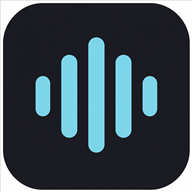

<h1 align="center">Voice Report · Laudos técnicos com IA</h1>

  SaaS para engenheiros e arquitetos produzirem laudos técnicos de vistoria direto no campo, 
  falando em vez de digitar. Áudio, fotos e checklist viram um laudo pronto em DOCX/PDF.

  <a href="https://www.voicereportapp.com/">🌐 Site do produto</a> ·
  <a href="https://www.laudopratico.com.br">📱 App em produção</a> ·
  <a href="https://github.com/voicereporttech/voicereport">📦 Repositório original</a> ·
  <a href="docs/arquitetura.md">🏗️ Arquitetura</a> ·
  <a href="docs/desafios-tecnicos.md">🧩 Desafios técnicos</a>

  
  
  
  
  
  
  
  

---

> **Sobre este repositório:** é uma vitrine de portfólio. O código-fonte fica no repositório original
> [`voicereporttech/voicereport`](https://github.com/voicereporttech/voicereport), que é **privado** por
> ser um produto comercial em operação. Aqui estão a descrição do trabalho, a arquitetura, as decisões
> técnicas e imagens do sistema. Acesso ao código para avaliação técnica pode ser liberado sob pedido.

## O problema

Um laudo de vistoria (entrega de imóvel, inspeção predial, patologias) costuma ser feito em duas etapas:
o profissional anota e fotografa no local e, depois, passa horas no escritório transcrevendo, organizando
fotos por ambiente e formatando o documento conforme as normas ABNT. É trabalho repetitivo e sujeito a erro.

## A solução

O **Voice Report** move a produção do laudo para o próprio local da vistoria:

1. **Nova vistoria**: cliente, endereço, tipo de vistoria e upload da ART/RRT.
2. **Coleta híbrida por ambiente**: o técnico **grava áudio**, tira fotos e vídeos, escreve observações
   e marca o **checklist de normas ABNT**. Também dá para importar mídias recebidas no WhatsApp.
3. **Funciona sem internet**: tudo é salvo no aparelho e sincronizado quando a conexão volta.
4. **IA gera o laudo**: os áudios são transcritos (Whisper) e o GPT-4o redige o laudo seguindo o
   **modelo de relatório do próprio escritório**, com fotos no lugar certo.
5. **Revisão e entrega**: ajuste manual ou revisão assistida por IA, assinaturas por cargo,
   conclusão técnica e exportação em **DOCX ou PDF**.

  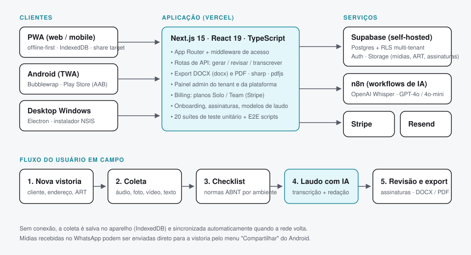

## Telas

| Painel inicial | Nova vistoria | Vistoria em campo |
|:---:|:---:|:---:|
| 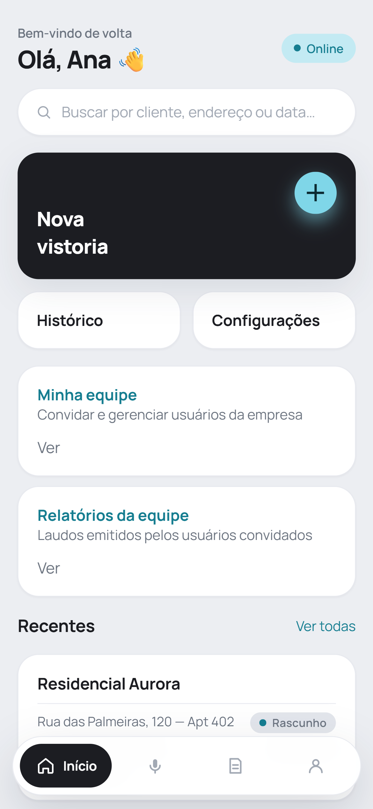 | 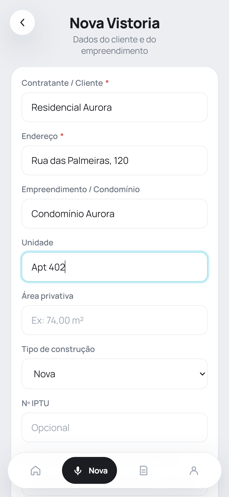 | 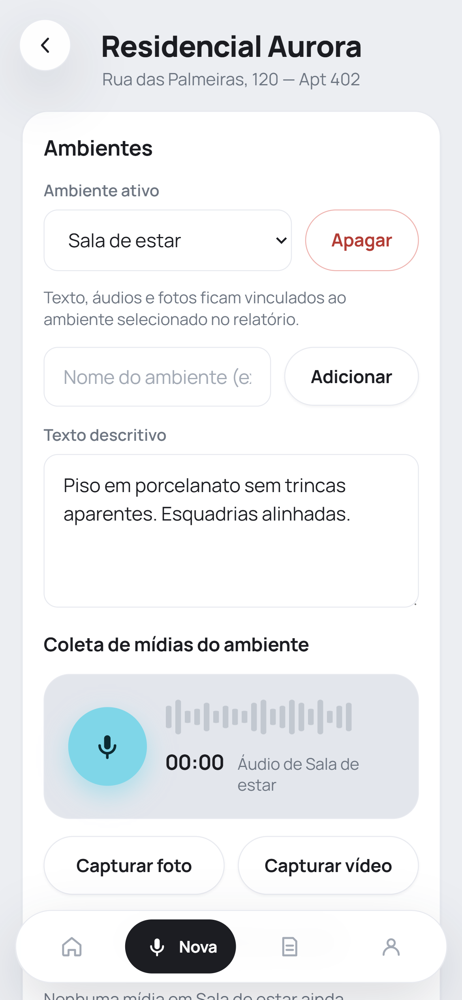 |
| Atalhos, equipe e vistorias recentes | Dados do cliente e do empreendimento | Ambientes, texto e gravação de áudio |

| Histórico | Laudo gerado | Laudo com fotos |
|:---:|:---:|:---:|
| 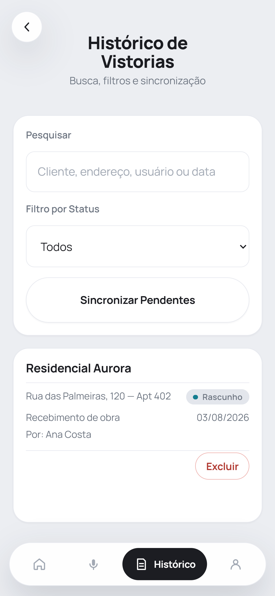 | 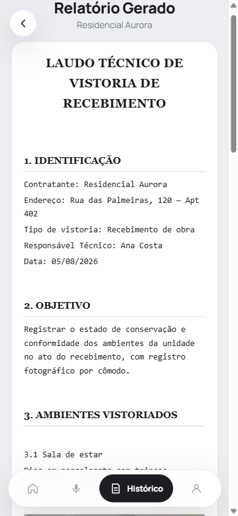 | 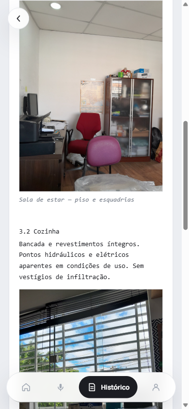 |
| Busca, filtro de status e sincronização | Laudo estruturado pela IA | Fotos embutidas por ambiente |

Telas de acesso

 

  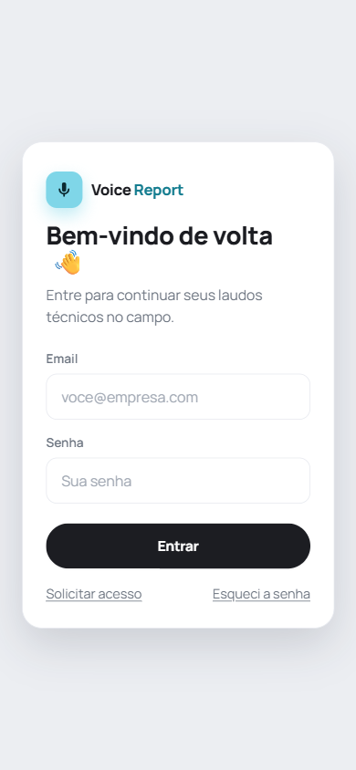
  &nbsp;&nbsp;
  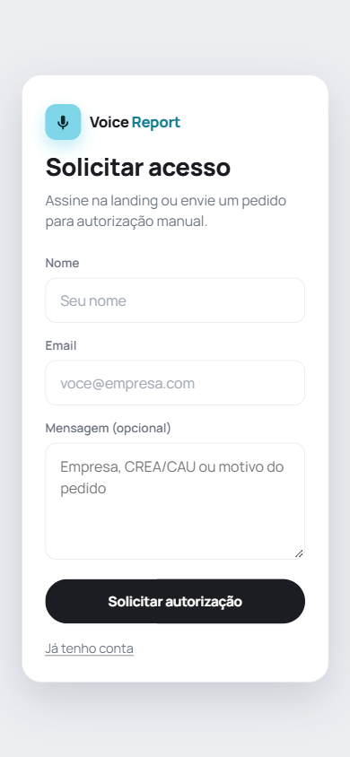

Telas com dados fictícios de demonstração, extraídas de <a href="https://www.voicereportapp.com/">voicereportapp.com</a>.

## Principais funcionalidades

| Área | O que foi construído |
|---|---|
| **Coleta em campo** | Ambientes, texto, gravação de áudio, foto e vídeo pela câmera nativa, checklist ABNT, importação em lote |
| **Offline-first** | Fila de mídias em IndexedDB, estratégia de gravação por estado de rede, sincronização automática e indicador de pendências |
| **IA** | 3 workflows n8n: transcrição (Whisper), geração de laudo (classificação + redação com GPT-4o) e revisão |
| **Modelos de laudo** | Biblioteca de modelos por usuário (DOCX/PDF). O texto do modelo guia a estrutura do laudo gerado |
| **Documento final** | Export DOCX/PDF com fotos embutidas e normalizadas, ART/RRT rasterizada, assinaturas dinâmicas por cargo |
| **Multi-tenant** | Escritórios (tenants) isolados por **Row Level Security**, papéis `platform_admin`, `tenant_admin` e `user` |
| **SaaS** | Planos Solo e Team (mensal/anual) com Stripe Checkout, Customer Portal, webhooks e bloqueio por inadimplência |
| **Gestão** | Painel do escritório (usuários, convites, laudos) e painel da plataforma (tenants, cobrança, métricas) |
| **Auth** | Cadastro com aprovação manual, convites e recuperação de senha com e-mails próprios (Resend) |
| **Distribuição** | PWA instalável com *share target*, app Android (TWA) na Play Store e app desktop Windows (Electron) |
| **Conformidade** | Política de privacidade e exclusão de conta pública (LGPD e Google Play) |

## Pipeline de IA

  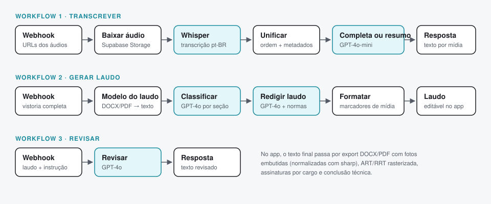

Os workflows ficam no **n8n** e são chamados pelas rotas de API do Next.js. Assim o prompt e a orquestração
evoluem sem novo deploy do app. Detalhes em [docs/arquitetura.md](docs/arquitetura.md).

## Stack

- **Frontend e backend:** Next.js 15 (App Router), React 19, TypeScript, CSS próprio ("field instrument" design system)
- **Dados:** Supabase self-hosted (Postgres, Auth, Storage) com 19 migrations e políticas RLS
- **IA e automação:** n8n, OpenAI Whisper, GPT-4o e GPT-4o-mini
- **Documentos:** `docx`, `pdfjs-dist`, `unpdf`, `sharp`, `@napi-rs/canvas`
- **Pagamentos e e-mail:** Stripe, Resend
- **Apps:** PWA com service worker, Android TWA (Bubblewrap), Electron + NSIS
- **Qualidade:** 20 suítes de teste unitário (`node:test`) e scripts E2E de autenticação, multi-tenant e IA
- **Deploy:** Vercel

## Números do projeto

- **~200 commits** entre julho e agosto de 2026
- **66 arquivos** em `app/` (páginas e 30+ rotas de API), **72** em `lib/`, **27** componentes
- **3 plataformas** de distribuição a partir de uma única base de código

## Meu papel

Projeto desenvolvido de ponta a ponta por **Daniel Lopes de Oliveira**: levantamento do PRD, design da
interface, modelagem do banco e das regras de acesso, integração com IA via n8n, cobrança recorrente,
empacotamento para Android e Windows e publicação na Play Store.

Veja os problemas reais resolvidos durante o desenvolvimento em
[docs/desafios-tecnicos.md](docs/desafios-tecnicos.md).

## Links

- Site do produto: <https://www.voicereportapp.com/>
- App: <https://www.laudopratico.com.br>
- Repositório original (privado): <https://github.com/voicereporttech/voicereport>
- Perfil: <https://github.com/daniellpsadm-boop>
